<div align="center">

# ▲ BarQuests

**Your calisthenics journey — training that places you per skill, adapts to every set, and proves your level.**

A mobile-first web app (installable as a PWA) for people who train on outdoor bars —
front lever, planche, muscle-up, handstand and 46 more skills.


<br/>

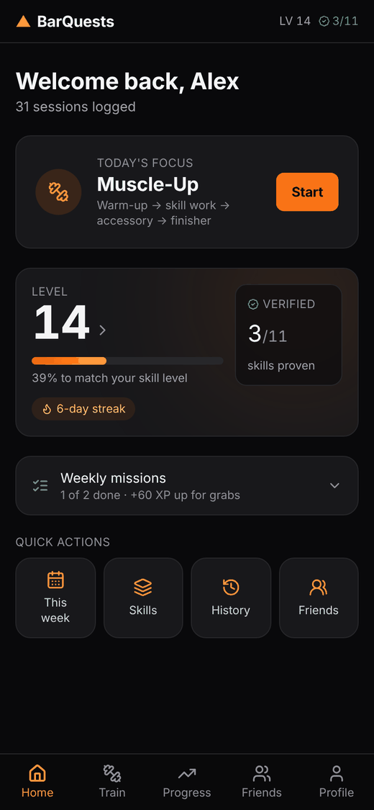
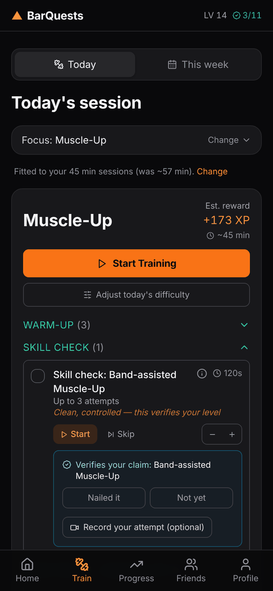
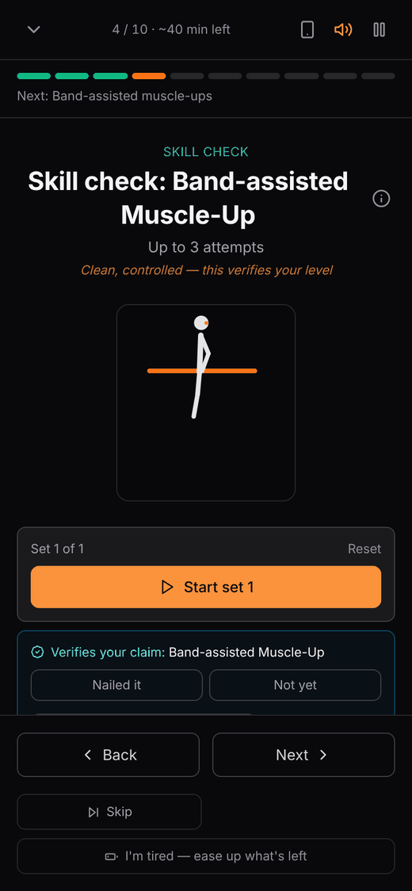
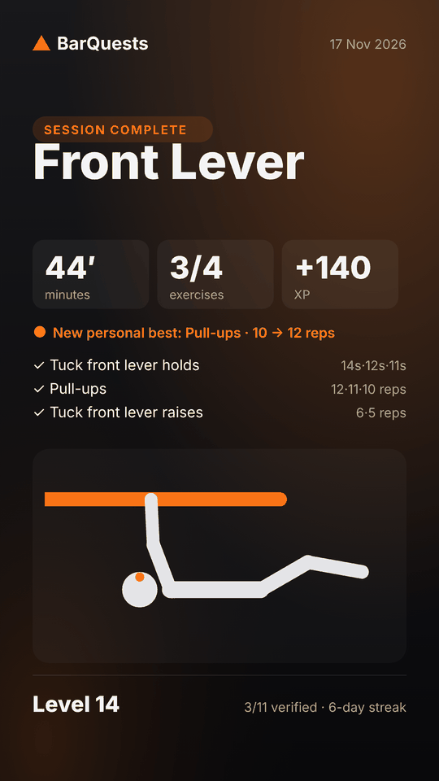

</div>

---

## Why BarQuests

Most training apps give everyone the same program, take your word for your level,
and forget how your last session went. BarQuests is built around four ideas:

- **Placed per area, not on one number.** The assessment rates pulling, pushing,
  balance, core, legs and levers separately — strong pullers who are new to pushing
  get the right work in both.
- **Adapts to every set.** Mark each exercise *done*, *skip* or *too hard*; the timer
  learns how long you actually rest and hold. The next session eases off, adds volume
  or steps up — exercise by exercise.
- **Proves your level.** Everything you claim ("10 push-ups", "a 5 s tuck front lever")
  gets tested by a Skill Check inside a normal session, or by matching sets in training.
  Your profile shows what's *verified*, not just what you said.
- **Made for the bar park.** Sessions use only the equipment you have, pairs can
  train together on one bar, and friends get a weekly challenge.

## Who it's for — and what it isn't

BarQuests is for people who train outdoors and are looking for challenges: skills to
unlock, sessions that keep up with them, and friends to compete with.

It is **not a replacement for a proper calisthenics course or a coach**:

- **The training plans aren't certified.** Sessions are generated from progressions
  common in calisthenics; they haven't been written or reviewed by a certified coach,
  trainer or physiotherapist.
- **Nobody checks what you're actually doing.** A trainer at the gym watches your
  technique and corrects it on the spot. The app only knows what you tap and what the
  timer measures: a Skill Check confirms you reached a number of reps or seconds, not
  that your form was right.
- **It doesn't know your body.** Pain, injuries, mobility limits and health conditions
  aren't taken into account beyond what you tell it.

If you're starting out, coming back from an injury, or working toward demanding skills
like the planche or iron cross, learning the basics from a qualified coach is the safer
route. Warm up, stop when something hurts, and check with a doctor before starting if
you have any health concerns.

## Features

### Getting started
- **Per-area assessment** — the hardest variation you can do of each main skill, how
  solid it is, plus side skills matched to your level in each area. About 2–3 minutes.
- **Try it first** — train as a guest with no account; *Save with Google* keeps
  everything when you're ready.

### Training
- **Sessions that fit your day** — warm-up → skill work → accessory → finisher, sized
  to the session length you chose (15–90 min) and the equipment you have.
- **Guided mode** — full-screen, hands-free: per-set timer, rest between exercises,
  and optional **voice coaching** (sets, “ten seconds”, “up next”), in English or Italian.
  Big buttons where your thumb is (Back, Next, More, Pause); skip, too hard, I'm tired,
  voice and lock-screen controls sit in one options sheet.
- **Animated demonstrations** — a stick-figure animation for 124 of the 129
  exercises that appear in sessions, plus the common mistakes for each movement.
- **Per-set logging** — log reps in the timer's rest screen; holds are measured
  automatically.
- **Lock-screen controls** *(opt-in)* — exercise, rest (with a progress bar) and
  next/previous on your lock screen.
- **Effort-aware** — every exercise has effort points (sets × how hard it is on the
  trophy road × how big each set is), so the app knows how far through a session you
  really are. *Too hard* or a skip near the end counts for less (it's mostly
  tiredness), *I'm tired* cuts what's left by more the earlier you are (easier swaps
  early, a set or two near the end — never the Skill Check), and when you keep running
  out of energy at the same point, sessions are trimmed to fit and say so.
- **Cool-down stretching** — after the last exercise (and on Today once you've trained),
  4–6 stretches for the muscles the session worked most: each exercise's load on lats,
  chest, shoulders, arms, wrists, core and legs, weighted by how much work it was. A
  guided run with a timer per hold; a wrist stretch whenever your hands were on the floor.
- **Warm-up for the whole session** — picked after the session is built, for the muscles
  every exercise in it will load; wrist prep whenever your hands bear weight, and only drills
  your equipment allows. Each drill says what it's getting ready.
- **Rest-day mobility** — on days off, about 10 minutes of movement and stretching that eases
  what the last three days loaded and keeps the whole body moving.
- **Works offline** — finish and log a session with no signal: it's saved on the phone and
  synced when you're back online.
- **Exercise library** — every exercise in the app, searchable and filterable (type, muscle
  group, your equipment), with its animation, how-to, stage and what it needs. **Do it now**
  runs any exercise on the spot in guided mode, with your own number of sets.
- **Sessions of your own** — pick exercises, set the sets, reorder, and run them in guided
  mode; save up to 20 to start again with one tap.
- **Training blocks** — aim for a stage in 4–12 weeks: two of every three sessions on that
  skill, a deload every 4th week, and a test at the end (move up, or two more weeks).
- **Bodyweight** — log your weight and see the trend; Then vs now shows strength for your
  weight and in absolute terms when it changed.
- **Vibration cues** — the phone buzzes when a set starts, rest starts and an exercise is
  done; switch it in Settings or from the session menu.
- **Bar parks near you** — a full-screen dark map of outdoor bars from OpenStreetMap: pins
  show how many kinds of kit each park has and group into one bubble when zoomed out, and
  the search range is drawn as a circle. Search around you or move the map anywhere and
  *Search this area*. Athletes say what each park really has (pull-up bar, dip bars,
  rings…), confirm it's still there or update it, and react to each other's updates; anyone
  can correct a park's name or move its pin, and missing parks are added by picking their
  spot on the map. *Train here today* builds the session for that park's kit plus what you
  carry. OpenStreetMap results are cached in Firestore per area by whoever loads them first
  (refreshed after 14 days, or on request at most once a day), so the map opens quickly and
  shows *updated on …*; if OpenStreetMap is down, the cached data is shown with its date.
- **Log only the sets you did** — *Finish here* between sets ends the exercise with
  just those sets logged; your totals and the learning count only what you did.
- **Sessions that survive interruptions** — the session in progress, where you are in it
  and any running timer are kept on the phone: close the app, reload or let the phone
  kill it, and it picks up where you left off. Timers keep real time while the phone is
  locked, the screen stays on during guided mode, and a *training in progress*
  notification (current exercise, when the rest ends) brings you back with one tap.

### More than one sport

- **Sport tracks, like learning more than one language** — calisthenics is the main track, and yoga and Pilates can be added from the sport chip in the header ("Your sports"). Each new sport starts with three questions: how much you've done (new, some, experienced, which sets the starting stage of every skill), up to three goal skills, and a session length.
- **Switch anytime, lose nothing** — each sport keeps its own skill stages, mastery, exercise history, records, XP and level. The weekly streak, total XP and missions are shared, so a yoga day keeps the streak alive.
- **Same loop as calisthenics** — Today builds a session for the active sport (warm-up, a focus that rotates and leans on your goals, supporting work, cool-down), fitted to your time. Feedback moves mastery up or down; five out of five unlocks the next stage. Skills shows each skill as a ladder, and the library and "Do it now" list that sport's exercises. Yoga: sun salutations, standing balances, crow, headstand, wheel, splits, forward fold, hips. Pilates: the hundred, roll-up, teaser, swan, side kicks, shoulder bridge, plank series, rolling.
- Weather, bar parks and the "where are you training?" question only appear for calisthenics, since the other sports are indoors.

### Learning and verification
- **Adaptive sessions** — swaps in an easier variation after “too hard”, brings the
  original back once you're ready, adds sets when you're consistent, remembers your
  usual rep tweaks, and matches rest to what you really take.
- **Noise-filtered timing** — readings taken while the app was in the background,
  during an interruption or from tapped-through sets are ignored, and nothing
  changes on the strength of a single session.
- **Skill Checks** — one per session, targeting something you claimed. Hit the target
  and it's verified; miss on two separate days and the coach suggests a step back.
  Record the attempt on video if you like (the clip stays on your phone).
- **Coach update** — after each session: mastery changes, new personal records,
  stage-up suggestions you accept or postpone, and a share button.

### Today
- **Today's session first** — the exercises, time and XP on the first screen, started
  in one tap; the week's done and planned days beside it, plus one goal to aim at
  (today's Skill Check, or the next skill to unlock).
- **Weather at your training time** — with your OK, the forecast (Open-Meteo) for the
  hour you usually train: rain suggests the closest dry hour, or a floor-only session
  indoors; very hot or cold hours get a tip. When rain sets in for several days, a home
  plan (floor, wall and your own kit) runs until it clears.
- **Status at a glance** — an app badge and a coloured dot on the tab icon: green when
  today's done, amber when your streak is at risk, blue mid-session.

### Skills
- **Headline** — your level and how many skills you've proven, front and centre.
- **Skill tree** — “Up next” pins the stages you're closest to; every skill shows its
  chain of stages with your current one highlighted.
- **Proven** — verified skills, the skill wall and the skill radar.
- **Trophy road** — the next milestones, with the full level-by-level road one tap away.
- **Level from experience only** — what you declare shapes your sessions, not your level.
  XP comes from the work you do (harder exercises earn more, only the sets you did
  count), with bonuses for proving a skill (+40), new records (+10) and stepping up a
  stage (+75).
- **Then vs now** — two weeks of training side by side: since you started, 1 or 3 months
  ago, or any dates. Strength per muscle group (harder variations count, not just more
  reps), skill stages then → now, and every exercise you did in both — best set, typical
  set and sets per session, with the % change — plus the harder exercises you've moved on to.
- **Skill timeline** — when your next stages should come ("Straddle · 2–3 months"), at the pace
  of your last six weeks.
- **Achievements** — 26 bronze, silver and gold badges for sessions, streaks, levels, verified
  skills, records and stage-ups, celebrated the moment you earn them.
- **Take back a mistake** — *Undo* a "too hard" swap during a session; afterwards mark a
  "too hard" or skipped exercise *Actually done* in your history, or tap *I can do this*
  on anything the coach is easing off.

### Coach
- **Ask your coach** — an AI chat that answers questions about *your* training data.
- **Coach insights** — what the app has learned from your sessions: what's going well,
  what's being eased off, and your real rest and hold times.
- **AI review and planning** — check today's session against your level, or plan the week.
- **Bonus wheel** — a prize wheel of 24 segments: the number you land on (1, 2, 5, 10)
  sets how hard the bonus exercise is, and ★ opens a pick-a-card bonus round. Two reels
  add a bonus or malus. Only skills and exercises your equipment allows come up.
  Optionally **bet XP** on where it lands (up to 5 bets a day, never the XP that holds
  your level); winnings are paid when you complete the exercise.

### Me
- **Activity** — your XP over time, a calendar, month totals, every session with its
  sets, and personal bests.
- **Your progress per exercise** — in the library, each exercise shows every time you did
  it in the last year: the best set over time, the typical set and your record.
- **Your totals** — reps and time per exercise this month, this year or all time
  ("128 toes-to-bar in November"), added up from your sessions: what you logged, or the
  prescription for sets you marked done (marked ≈). Warm-ups don't count, and max sets
  only count when logged.

### Social
- **Friends** — add by code, nudge each other (funny, personalised lines by mood, or your own message), and see a **weekly leaderboard** with a
  rotating challenge (sessions, minutes, skills proven, XP).
- **Global leaderboard** — switch the board to *Everyone* to see the week's top 50
  across the app. It's opt-in: you only appear after joining, as first name and last
  initial, and you can leave any time.
- **Crew activity** — your friends' finished sessions from the last two weeks (focus,
  time, XP, new records), with kudos in one tap. Only friends see yours, and sharing can
  be turned off in Settings.
- **Nudge replies** — answer a friend's nudge in one tap (*On it!*, *Later today*, *Rest day*);
  *Done!* on a challenge nudge earns a little XP, up to three times a day.
- **Monthly community event** — one theme a month (*Push-up December*, *Handstand
  October*…), a goal everyone works toward together and a goal of your own. Your part
  is counted from your sessions; only the number is shared, never your name.
- **Train together** — a shared session where each person gets work at their own level;
  with one bar between you, rests double so you take turns.
- **Share cards** — session, verified-skill and personal-best images in story or square
  format, straight to the share sheet. Your name only appears if you opt in.

### Account and privacy
- English and Italian, daily reminders, and a **weekly streak**: one session a week keeps it going (rest days never break it), with an amber dot on the app icon when the week is about to end without one.
- **Your data** — export everything as JSON, or reset in steps up to deleting the
  account, each showing exactly what it removes and keeps.
- `.tcx` export of any session, for platforms that import workout files (e.g. Strava,
  Garmin Connect).
- **Accessible** — works with a keyboard and screen readers (skip link, real headings,
  labelled controls, dialogs that keep focus, announced messages), pinch-zoom allowed,
  WCAG AA contrast; checked with axe on every screen.

<details>
<summary><b>More screenshots</b></summary>
<br/>

| Landing | Assessment | Skill tree | History |
|:-:|:-:|:-:|:-:|
| 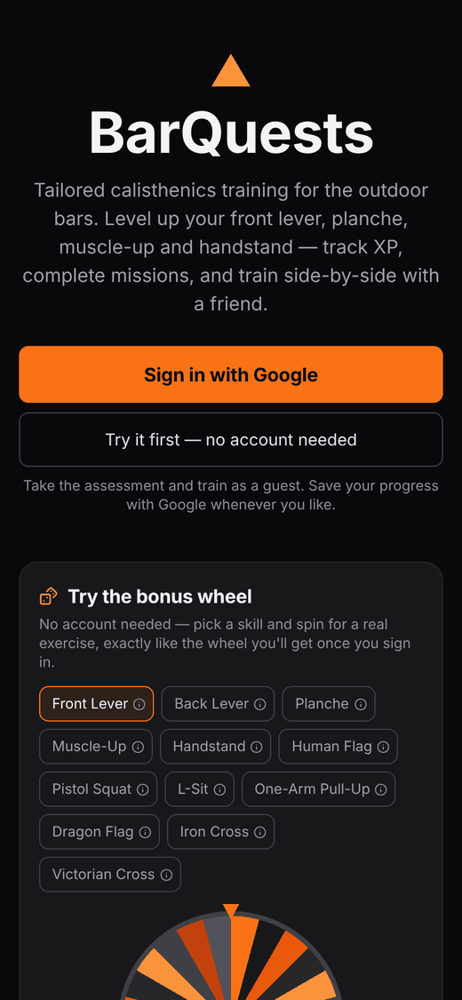 | 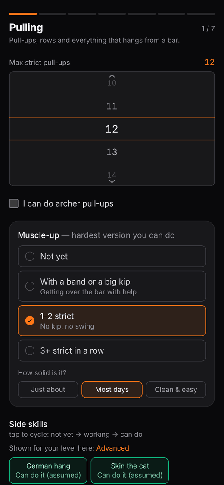 | 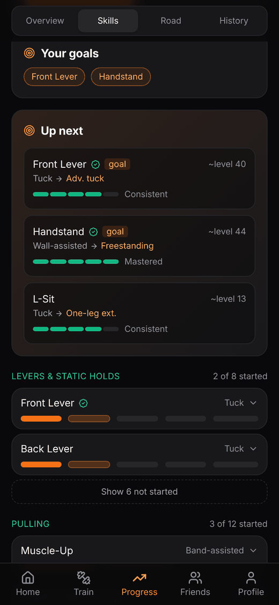 | 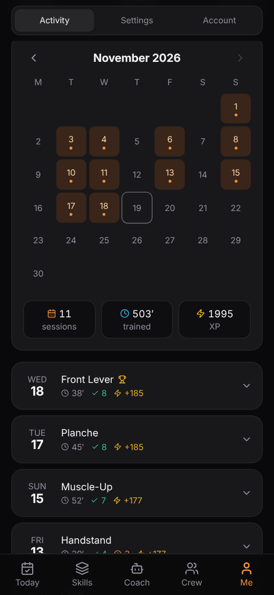 |

| Friends | Ask your coach | Guided mode | Share card |
|:-:|:-:|:-:|:-:|
| 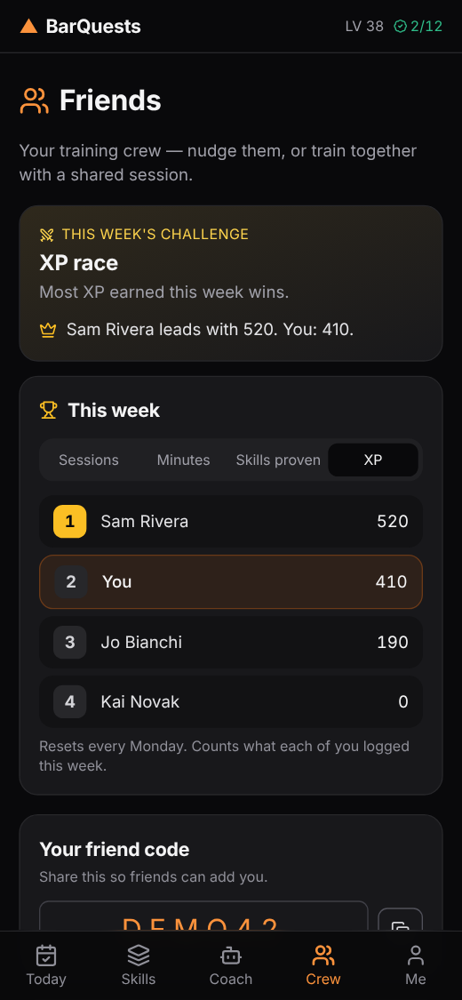 | 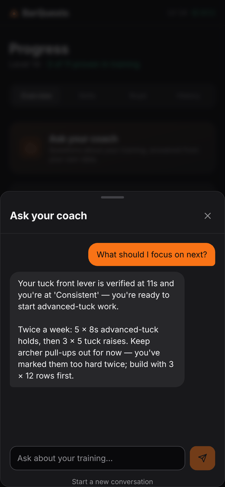 |  |  |

</details>

## How the adaptive loop works

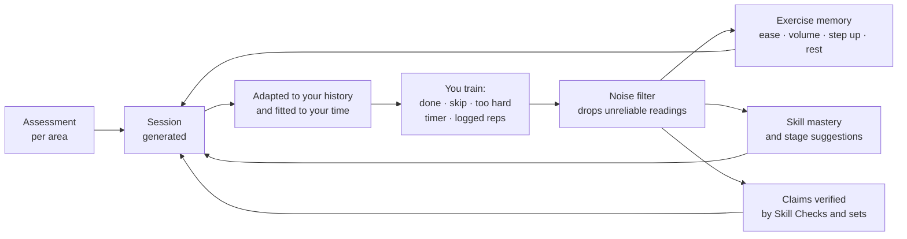

Every finished session updates three layers of memory: how each **exercise** went
(and how long you rested and held), how each **skill** is progressing, and which of
your **claims** are now proven. The next session is generated from your skill stages
and then adapted using all three. The logic lives in plain, tested TypeScript modules —
see [Project structure](#project-structure).

## Tech stack

- **Next.js 14** (App Router) and **TypeScript**, styled with **Tailwind CSS**
- **Firebase Authentication** (Google and anonymous/guest) and **Cloud Firestore**
- **OpenRouter** for the optional AI features (coach chat, exercise tips, plan review)
- No chart, animation or i18n libraries — charts, the stick-figure rig and the
  translation layer are small, purpose-built modules
- Unit tests with Node's built-in test runner (`npm test`), and browser tests with
  Playwright and axe (`npm run e2e`) on every screen; both run on every pull request
- Lighthouse on every pull request (landing, `/it`, About): scores on the run's summary page;
  accessibility or SEO below 95 fails the check (`lighthouserc.json`)

## Getting started

### Prerequisites
- Node.js 18.17 or newer
- A Firebase project (the free Spark plan is enough)
- Optional: an [OpenRouter](https://openrouter.ai/keys) API key for the AI features
  (free-tier models work)

### 1. Install

```bash
npm install
cp .env.local.example .env.local
```

### 2. Set up Firebase

1. Create a project at [console.firebase.google.com](https://console.firebase.google.com).
2. **Authentication → Sign-in method** — enable **Google** and **Anonymous**
   (Anonymous powers “Try it first”; without it, the guest button explains it isn't
   available and Google sign-in still works).
3. **Firestore Database** — create a database in production mode.
4. **Project settings → Your apps** — add a **Web app** and copy its config into
   `.env.local`:

```
NEXT_PUBLIC_FIREBASE_API_KEY=...
NEXT_PUBLIC_FIREBASE_AUTH_DOMAIN=...
NEXT_PUBLIC_FIREBASE_PROJECT_ID=...
NEXT_PUBLIC_FIREBASE_STORAGE_BUCKET=...
NEXT_PUBLIC_FIREBASE_MESSAGING_SENDER_ID=...
NEXT_PUBLIC_FIREBASE_APP_ID=...

# optional — enables the AI coach chat, tips and plan review
OPENROUTER_API_KEY=...
OPENROUTER_MODEL=openrouter/free

# optional — push notifications (see "Optional: push, App Check, Remote Config")
NEXT_PUBLIC_FIREBASE_VAPID_KEY=...
FIREBASE_SERVICE_ACCOUNT={"type":"service_account",...}   # server only, keep secret
CRON_SECRET=...                                            # server only, any long random string

# optional — App Check (Fraud Defense key; or NEXT_PUBLIC_RECAPTCHA_SITE_KEY for classic reCAPTCHA v3)
NEXT_PUBLIC_RECAPTCHA_ENTERPRISE_KEY=...
APP_CHECK_MODE=monitor          # off | monitor | enforce

# optional — the public address for search engines and link previews; on Vercel
# the production address is used automatically, set this for a custom domain
NEXT_PUBLIC_SITE_URL=https://your-domain.example
```

5. **Firestore → Rules** — paste the rules below.

<details>
<summary><b>Firestore security rules</b></summary>

```
rules_version = '2';
service cloud.firestore {
  match /databases/{database}/documents {
    match /users/{uid} {
      allow read, write: if request.auth != null && request.auth.uid == uid;

      match /friends/{friendUid} {
        allow read: if request.auth != null && request.auth.uid == uid;
        // both sides of a mutual add need to write: the person adding writes
        // their own list (auth.uid == uid) AND mirrors the entry into the
        // other person's list (auth.uid == friendUid, the doc's own id).
        allow write: if request.auth != null &&
          (request.auth.uid == uid || request.auth.uid == friendUid);
      }

      // finished-session history, private to its owner
      match /sessions/{sessionId} {
        allow read, write: if request.auth != null && request.auth.uid == uid;
      }

      match /pings/{pingId} {
        allow read, delete: if request.auth != null && request.auth.uid == uid;
        // only an established friend can drop a nudge in your inbox
        allow create: if request.auth != null && request.auth.uid != uid &&
          request.resource.data.fromUid == request.auth.uid &&
          request.resource.data.message is string &&
          request.resource.data.message.size() <= 200 &&
          exists(/databases/$(database)/documents/users/$(uid)/friends/$(request.auth.uid));
      }

      // the crew feed: your finished sessions, for your friends to see;
      // a friend may only add or take back their own kudos
      match /feed/{itemId} {
        allow read: if request.auth != null && (request.auth.uid == uid ||
          exists(/databases/$(database)/documents/users/$(uid)/friends/$(request.auth.uid)));
        // the owner writes it (and rewrites it without their name when the
        // account is deleted — see anonymize.ts)
        allow create, update: if request.auth != null && request.auth.uid == uid
          && request.resource.data.uid == uid
          && request.resource.data.keys().hasOnly(['uid', 'name', 'focusLabel', 'minutes', 'xp', 'exercises', 'records', 'streak', 'paired', 'createdAtISO', 'kudos'])
          && request.resource.data.name is string && request.resource.data.name.size() <= 40
          && request.resource.data.records is list && request.resource.data.records.size() <= 3;
        allow update: if request.auth != null && request.auth.uid != uid
          && exists(/databases/$(database)/documents/users/$(uid)/friends/$(request.auth.uid))
          && request.resource.data.diff(resource.data).affectedKeys().hasOnly(['kudos'])
          && request.resource.data.get('kudos', {}).diff(resource.data.get('kudos', {})).affectedKeys().hasOnly([request.auth.uid]);
        allow delete: if request.auth != null && request.auth.uid == uid;
      }
    }

    // minimal public info so friends can be found by code — see PublicProfile.
    // "get" only: a profile can be opened by its id, but the collection can't
    // be listed, so nobody can download every player's profile.
    match /profiles/{uid} {
      allow get: if request.auth != null;
      allow write: if request.auth != null && request.auth.uid == uid;
    }

    // friend-code -> uid reverse lookup, one doc per user, immutable once set.
    // "get" only, or listing it would reveal every uid.
    match /usercodes/{code} {
      allow get: if request.auth != null;
      allow create: if request.auth != null && request.resource.data.uid == request.auth.uid;
      // released when its owner deletes their account
      allow delete: if request.auth != null && resource.data.uid == request.auth.uid;
    }

    match /pairings/{code} {
      // opened by code; listed only for your own (account deletion finds them)
      allow get: if request.auth != null;
      allow list: if request.auth != null && resource.data.hostUid == request.auth.uid;
      allow create: if request.auth != null && request.resource.data.hostUid == request.auth.uid;
      allow update: if request.auth != null &&
        (resource.data.hostUid == request.auth.uid ||
         request.resource.data.guestUid == request.auth.uid);
      // pairings hold the host's body stats and skills — removed on account deletion
      allow delete: if request.auth != null && resource.data.hostUid == request.auth.uid;
    }

    // opt-in global weekly leaderboard: a short name, level and the week's
    // totals only. Anyone signed in can read it; only the owner writes their
    // own entry, guests can't, and numbers must be ones a real week allows
    // (the same limits as BOARD_LIMITS in src/lib/leaderboard.ts).
    match /leaderboard/{week}/entries/{uid} {
      function count(v, max) { return v is int && v >= 0 && v <= max; }
      allow read: if request.auth != null;
      allow create, update: if request.auth != null && request.auth.uid == uid
        && request.auth.token.firebase.sign_in_provider != 'anonymous'
        && week.matches('^[0-9]{4}-W[0-9]{2}$')
        && request.resource.data.keys().hasOnly(['name', 'level', 'sessions', 'minutes', 'verified', 'xp'])
        && request.resource.data.name is string && request.resource.data.name.size() <= 40
        && request.resource.data.level is int && request.resource.data.level >= 1 && request.resource.data.level <= 1000
        && count(request.resource.data.sessions, 21)
        && count(request.resource.data.minutes, 1800)
        && count(request.resource.data.verified, 30)
        && count(request.resource.data.xp, 20000);
      allow delete: if request.auth != null && request.auth.uid == uid;
    }

    // monthly community events: one number per player, which the app sums
    // with an aggregation query (that needs read access to the collection)
    match /events/{month}/players/{uid} {
      allow read: if request.auth != null;
      allow create, update: if request.auth != null && request.auth.uid == uid
        && month.matches('^[0-9]{4}-[0-9]{2}$')
        && request.resource.data.keys().hasOnly(['value', 'updatedAtISO'])
        && request.resource.data.value is int
        && request.resource.data.value >= 0 && request.resource.data.value <= 100000;
      allow delete: if request.auth != null && request.auth.uid == uid;
    }

    // bar parks: parks athletes added (OpenStreetMap ones have no doc) and
    // each athlete's one report per park. Others may only change their own
    // reaction on a report.
    match /parks/{parkId} {
      function validSpot(d) {
        return d.name is string && d.name.size() <= 60
          && d.lat is number && d.lat >= -90 && d.lat <= 90
          && d.lon is number && d.lon >= -180 && d.lon <= 180
          && d.cell is string && d.cell.size() <= 16;
      }
      allow read: if request.auth != null;
      // an athlete's own park, or the first community edit of an
      // OpenStreetMap park (its doc id is the map's id, "osm-…")
      allow create: if request.auth != null
        && request.resource.data.keys().hasOnly(['name', 'lat', 'lon', 'cell', 'source', 'createdBy', 'createdAtISO', 'editedBy', 'editedByName', 'editedAtISO'])
        && request.resource.data.createdBy == request.auth.uid
        && validSpot(request.resource.data)
        && ((request.resource.data.source == 'user' && request.resource.data.name.size() > 0)
          || (request.resource.data.source == 'osm' && parkId.matches('^osm-[nwr][0-9]+$')));
      // anyone may correct a park's name or position, as themselves
      allow update: if request.auth != null
        && request.resource.data.diff(resource.data).affectedKeys().hasOnly(['name', 'lat', 'lon', 'cell', 'editedBy', 'editedByName', 'editedAtISO'])
        && request.resource.data.editedBy == request.auth.uid
        && request.resource.data.editedByName is string && request.resource.data.editedByName.size() <= 40
        && validSpot(request.resource.data);
      allow delete: if request.auth != null && resource.data.createdBy == request.auth.uid;

      // likes: one per athlete (the count is in parkStats)
      match /likes/{uid} {
        allow read: if request.auth != null;
        allow create: if request.auth != null && request.auth.uid == uid
          && request.resource.data.keys().hasOnly(['atISO']) && request.resource.data.atISO is string;
        allow delete: if request.auth != null && request.auth.uid == uid;
      }

      // sessions logged here: one doc per athlete, its count only goes up by one
      match /trained/{uid} {
        allow read: if request.auth != null;
        allow create: if request.auth != null && request.auth.uid == uid
          && request.resource.data.keys().hasOnly(['sessions', 'firstISO', 'lastISO'])
          && request.resource.data.sessions == 1;
        allow update: if request.auth != null && request.auth.uid == uid
          && request.resource.data.diff(resource.data).affectedKeys().hasOnly(['sessions', 'lastISO'])
          && request.resource.data.sessions == resource.data.sessions + 1;
      }

      match /reports/{uid} {
        allow read: if request.auth != null;
        allow create, update: if request.auth != null && request.auth.uid == uid
          && request.resource.data.uid == uid
          && request.resource.data.keys().hasOnly(['uid', 'name', 'kit', 'note', 'atISO', 'reactions'])
          && request.resource.data.kit is map && request.resource.data.kit.size() <= 6
          && request.resource.data.name is string && request.resource.data.name.size() <= 40
          && (!('note' in request.resource.data) || (request.resource.data.note is string && request.resource.data.note.size() <= 140));
        allow update: if request.auth != null && request.auth.uid != uid
          && request.resource.data.diff(resource.data).affectedKeys().hasOnly(['reactions'])
          && request.resource.data.get('reactions', {}).diff(resource.data.get('reactions', {})).affectedKeys().hasOnly([request.auth.uid])
          && request.resource.data.get('reactions', {}).get(request.auth.uid, 'thanks') in ['thanks', 'strong', 'fire'];
        allow delete: if request.auth != null && request.auth.uid == uid;
      }
    }
    // public counts per park: likes and athletes who trained there. Each
    // change is ±1 and must come in the same batch as the like (or the first
    // visit) it counts — so nobody can inflate them.
    match /parkStats/{parkId} {
      function base() { return resource == null ? {} : resource.data; }
      function stepped(field, by) {
        return request.resource.data.get(field, 0) == base().get(field, 0) + by;
      }
      function likeDoc() { return /databases/$(database)/documents/parks/$(parkId)/likes/$(request.auth.uid); }
      function visitDoc() { return /databases/$(database)/documents/parks/$(parkId)/trained/$(request.auth.uid); }
      allow read: if request.auth != null;
      allow create, update: if request.auth != null
        && request.resource.data.keys().hasOnly(['likes', 'people'])
        && (
          (request.resource.data.diff(base()).affectedKeys().hasOnly(['likes'])
            && ((stepped('likes', 1) && !exists(likeDoc()) && existsAfter(likeDoc()))
              || (stepped('likes', -1) && exists(likeDoc()) && !existsAfter(likeDoc()))))
          || (request.resource.data.diff(base()).affectedKeys().hasOnly(['people'])
            && stepped('people', 1) && !exists(visitDoc()) && existsAfter(visitDoc()))
        );
    }

    // OpenStreetMap parks, cached per 0.1° cell by whoever loads an area
    // first, so everyone else skips the slow Overpass query. A cell can be
    // refreshed at most once a day, and the date is the server's.
    match /osmCache/{cell} {
      allow read: if request.auth != null;
      allow create, update: if request.auth != null
        && cell.matches('^-?[0-9]{1,4}:-?[0-9]{1,4}$')
        && request.resource.data.keys().hasOnly(['cell', 'parks', 'fetchedAt'])
        && request.resource.data.cell == cell
        && request.resource.data.parks is list && request.resource.data.parks.size() <= 400
        && request.resource.data.fetchedAt == request.time
        && (resource == null || resource.data.fetchedAt < request.time - duration.value(1, 'd'));
    }

    // account deletion (which anonymises your reports) finds them on every park (collection group);
    // it needs a single-field index exemption on reports.uid (collection group)
    match /{path=**}/reports/{uid} {
      allow read: if request.auth != null && request.auth.uid == uid;
    }
  }
}
```

</details>

### Optional: push, App Check, Remote Config

All three are free on Firebase's no-cost plan, and the app works without them.

**Push notifications** — reminders, friends' nudges and train-together invites reach
the phone even when the app is closed (on iPhone: the app installed to the home
screen, iOS 16.4+).
1. **Project settings → Cloud Messaging → Web Push certificates** — generate a key
   pair; put the public key in `NEXT_PUBLIC_FIREBASE_VAPID_KEY`.
2. **Project settings → Service accounts → Generate new private key** — put the whole
   JSON file's contents in `FIREBASE_SERVICE_ACCOUNT` (a server-only secret: never a
   `NEXT_PUBLIC_` variable). The server uses it to send pushes and read push tokens.
3. Pick any long random `CRON_SECRET`. For the hourly reminder run, add two
   **repository secrets** on GitHub (Settings → Secrets and variables → Actions):
   `APP_URL` (your deployed URL) and `CRON_SECRET` (the same value) — the workflow in
   `.github/workflows/reminders.yml` does the rest. Each athlete is reminded at their
   own local time, once a day, and not if they've trained.

**App Check** — proves requests to the AI and push routes (and, if you enforce it
there, Firestore) come from your app.
1. In Google Cloud (same project) → **Security → Fraud Defense** (formerly reCAPTCHA
   Enterprise), create a **Website** key for your domain(s). In **Firebase → App Check
   → Apps**, register the web app with **Fraud Defense** using that key, and put the
   same key in `NEXT_PUBLIC_RECAPTCHA_ENTERPRISE_KEY`. (Classic reCAPTCHA v3 is
   deprecated; it still works with `NEXT_PUBLIC_RECAPTCHA_SITE_KEY`.)
2. Start with `APP_CHECK_MODE=monitor`: requests without a valid token are only logged.
   Once the logs and the App Check console show your real traffic passing, switch to
   `enforce` — and, if you like, enforce it for Firestore in the console too.
3. For local development, register a debug token in the console and put it in
   `NEXT_PUBLIC_APPCHECK_DEBUG_TOKEN`.

**Remote Config** — tune XP values, effort thresholds and two feature switches
(global leaderboard, AI coach chat) without a release. Upload
`remoteconfig.template.json` with the Firebase CLI (`firebase deploy --only
remoteconfig`) or add the same parameters in the console; anything missing, mistyped
or out of range keeps its default. Set `NEXT_PUBLIC_REMOTE_CONFIG=off` to skip it.

### 3. Run

```bash
npm run dev        # http://localhost:3000
npm run demo       # same, signed in as an example athlete — no Firebase needed
npm test           # unit tests
npm run e2e        # browser tests: every screen + accessibility scan (Playwright)
npm run lint
npm run build && npm start   # production build
```

**Demo mode** (`npm run demo`) signs in a fictional athlete with three weeks of example
training, friends and Skill Checks, all kept in memory, so you can try every signed-in
screen without a Firebase project. A "DEMO" tab on the left edge marks it. It only runs on
the development server: production builds never include it. The AI features answer with
canned, clearly labelled demo replies, so no OpenRouter key is needed either.

On a phone (or any production build) the app can be installed from the browser's
*Add to Home Screen* / install prompt — it ships a web manifest and a service worker.

### Deploying

The app deploys to [Vercel](https://vercel.com) as a standard Next.js project: import
the repository, add the same environment variables, and add your deployment's domain
under **Firebase → Authentication → Settings → Authorized domains** so Google sign-in
works there.

Search engines see the landing page and About only (`/sitemap.xml`, `/robots.txt`); the
signed-in screens have their own tab titles but are kept out of the index. Link
previews use the generated picture from `src/app/opengraph-image.tsx`. To get the app
listed sooner, add the site to [Google Search Console](https://search.google.com/search-console)
and submit `https://<your-domain>/sitemap.xml`.

## Project structure

```
src/
├── app/                 # routes: dashboard (Today), training, plan, skills, coach,
│   │                    # friends (Crew), profile (Me), onboarding, wheel, about, landing
│   └── api/             # AI routes: coach-chat, exercise-tip, plan-review, plan-coach
├── components/          # UI (guided mode, session view, skill tree, share sheet, …)
├── context/             # auth, training session, language, toasts
└── lib/
    ├── trainingGenerator.ts, trainingData.ts   # session generation
    ├── sessionFit.ts                           # fitting sessions to your time
    ├── adaptation.ts                           # exercise and skill learning
    ├── timingLearning.ts                       # timer data + noise filtering
    ├── verification.ts                         # claims and Skill Checks
    ├── assessment.ts                           # the per-area assessment
    ├── sessionHistory.ts, store.ts             # history, records, Firestore
    ├── demos/                                  # stick-figure rig and movement templates
    ├── shareCards.ts                           # share-card SVG builder
    ├── leaderboard.ts, coachContext.ts         # friends board, AI coach context
    ├── server/                                 # AI route login check + rate limits
    ├── demoMode/                               # example athlete + in-memory store (npm run demo)
    └── i18n/                                   # English/Italian phrase tables
tests/                   # unit tests for the modules above
docs/
├── DEVELOPER_NOTES.md   # detailed implementation notes
└── screenshots/
```

## Privacy

- **What's stored:** your Google profile basics and what you enter or log (body stats,
  equipment, skills, sessions, friends) in Firestore, readable only by you — except a
  small public profile (name, photo, level, streak, XP, session count, skills and this
  week's totals) that signed-in users can see so friends can find you. Guests get no
  public profile.
- **AI features** send training data only (skills, what's verified or difficult,
  equipment, recent sessions, and your question) to OpenRouter — never your name, email
  or body stats. Chat conversations are not stored on a server.
- **AI routes need a login.** Each request carries the user's Firebase ID token, which
  the server checks against Google's public keys, and every account has a request budget
  (smaller for guests) so the OpenRouter key can't be drained by strangers.
- **Skill Check videos** never leave your device.
- **Location** (weather and parks) is rounded to about 1 km and kept on the device; only
  that point goes to Open-Meteo, and (through the app's own `/api/parks/osm` route, since browsers can't call Overpass reliably) to OpenStreetMap's Overpass API. Park photos load from Wikimedia Commons. Park reports (first
  name, equipment, optional note) are visible to signed-in users; the crew feed only to
  your friends.
- **Your controls:** export everything, reset progress in steps, or delete the account
  (which also removes you from friends' lists).
- **Deleting an account anonymises it** (GDPR art. 17 and recital 26; `src/lib/anonymize.ts`).
  Documents aren't removed, so links between them and the app's overall numbers keep
  working, but everything that identifies the person is erased:
  - each document is **rebuilt from a whitelist** of training fields, so a personal field
    added in future is dropped by default;
  - names become "Former athlete"; email, photo, body stats, weight log, notes, saved
    session names, push addresses, time zone and the friend code go;
  - exact times become days (sessions, records, feed, park reports) or months
    (sign-up, achievements);
  - relationships with other people (both sides of each friendship, the inbox) are
    deleted, as is the friend-code lookup;
  - kept, anonymously: sessions and exercises, XP, skill stages, the week's board numbers,
    the month's event contribution, park equipment votes, kudos counts;
  - finally the Firebase sign-in is deleted, so the uid on those documents points to no
    one; signing in again creates a new uid. An account whose data is anonymised but
    whose sign-in removal didn't finish is signed out on its next load.

  Anonymised accounts carry `anonymized: { month, reason: "account-deletion" }`, so
  counts can tell them apart (`where("anonymized.reason", "==", "account-deletion")`).
  Not covered: a nudge you sent that's still unread in a friend's inbox (it carries your
  first name until they open it), invites where you were the guest, and Firestore's own
  backups, which expire on their schedule.

## Limitations

- **Apple Health and Google Health Connect** can't be written from a web app; that
  would need a native wrapper. Sessions can be exported as `.tcx` instead.
- **Leaderboard totals are self-reported** by each player's device. The global board
  hides weeks no real athlete could log, but it isn't tamper-proof — that would need
  the totals computed on a server.
- **No true background timer.** Browsers suspend web pages that aren't on screen, so a
  timer can't beep or move on by itself while the app is closed — it catches up the
  moment you're back, and the notification shows an end time instead of a live
  countdown. The notification needs notification permission, and on iPhone the app
  installed to the home screen (iOS 16.4+). A native app could do more.
- **Push needs the setup above.** Without it, reminders only arrive if you've opened
  the app recently, and nudges only show up while it's open.
- **Lock-screen controls** need a silent audio track while active, which can pause other
  apps' music on some phones — hence opt-in.
- **AI answers** depend on the model configured in `OPENROUTER_MODEL`.
- **AI rate limits are kept in memory** on each server instance, so they're a
  best-effort cap rather than an exact one on serverless hosting.

## Documentation

- [Developer notes](docs/DEVELOPER_NOTES.md) — how individual features work and why.
- [Next ideas](docs/NEXT_IDEAS.md) — what to test, decide and build next.

## License

[MIT](LICENSE) © 2026 Michele Pulvirenti

## Author

Built by **Michele Pulvirenti** —
[GitHub](https://github.com/MikeCheek) ·
[Portfolio](https://michelepulvirenti.vercel.app/) ·
[Support on Ko-fi](https://ko-fi.com/michelepulvirenti)
